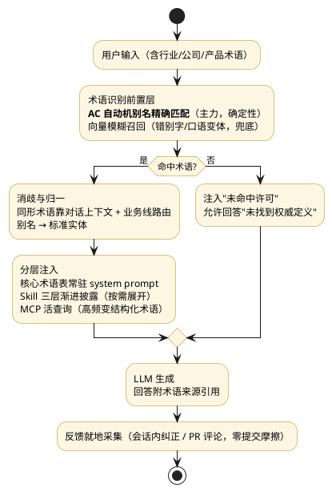
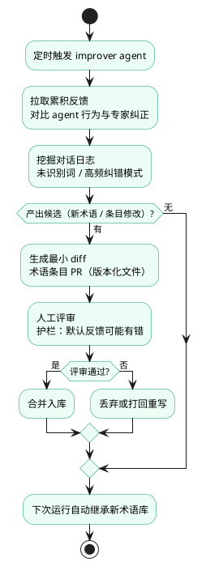

# glossary-agent — 企业级 Agent 术语理解技术方案

> **定位**：设计文档（调研结论 + 架构设计）。POC 未启动，落地时以本文档为基准。
> **调研基础**：Anthropic 官方博客深读 16 篇（2023-08 ~ 2026-09）+ Microsoft GraphRAG，全部为运行时注入的真实企业案例。
> **日期**：2026-09-04　|　**维护**：与 `diagrams.puml` 同目录，图变更需重跑 puml 校验渲染。
> **姊妹项目（2026-10-16 补）**：文档知识层见 [../knowledge-lattice/](../knowledge-lattice/)，双层分工与集成方式见[文末附录](#附与-knowledge-lattice-的分工与集成2026-10-16-补)。

---

## 1. 问题定义

企业级 agent 要听懂三类词汇：

| 类型 | 例子 | 特点 |
|---|---|---|
| 行业术语 | IRR、FHIR、_prior authorization_ | 模型可能懂个大概，但口径未必与公司一致 |
| 公司内部黑话 | "星环"、"上会"、"小蜜" | 模型完全不懂，且只存在于口头和私聊 |
| 产品名/代号/缩写 | TDH、ACP、产品 v3 内部代号 | 短文本，embedding 无信号，同名冲突多 |

**本质拆解**：这是「实体归一化（多说法 → 一概念）+ 定义注入（LLM 缺的是定义不是推理力）」问题，不是"知识量"问题。

**规模预期**：几百到几万条，随新产品/新项目持续新增。

---

## 2. 调研核心结论

> 以下五条均有案例实证，是本方案的全部设计依据。

1. **没有一家微调**。16 篇案例（金融尽调 Hebbia、临床抽象 Carta、法律 Thomson Reuters、自改进 Warp 等）全部走**运行时注入 + 可版本化文本工件**（skill 文件、prompt、策展语料）。知识活在文件里不活在权重里：当天可改、可审查、可回滚、换模型不丢。
2. **词典精确匹配 > 向量检索**（对短术语）。Anthropic Contextual Retrieval 官方明确：BM25 词法匹配对"技术术语、唯一标识符"最有效（例 "Error code TS-999"），embedding 对缩写/代号几乎无信号；hybrid 检索失败率降 49%，加 reranker 降 67%。
3. **渐进式披露是大量术语的正确姿势**。Anthropic 为 Claude 5 代模型删掉了 Claude Code 80% 以上系统提示词无效果损失——过度约束比欠约束更伤。Skills 三层 token 预算：索引 ~50 → 速查 ~500 → 详情 2000+。
4. **术语库是复利资产，靠闭环自增长**（Warp 模式）。版本化文件 + PR 评审 + 定时 improver agent 挖掘反馈提最小修改 + 人审合并，下次运行自动继承。
5. **验收 = 与资深专家的一致率，不是准确率**。eSentire 95% 一致率、Carta inter-rater reliability 98–99%（行业金标准）。

---

## 3. 总体架构



渲染产物：[`out/term-pipeline.svg`](./out/term-pipeline.svg)

设计要点：

- **识别层是独立前置层**，不指望模型自己认术语——词典匹配是确定性的，可单测、可度量（这是 Carta"细粒度归因"的前提：错误能定位在识别、消歧还是注入）
- **注入分三条通道**（见第 6 节选型表），核心表常驻、成体系术语按需展开、高频变结构化术语活查询
- **反馈采集嵌在工作现场**（会话内 / PR 评论），Warp 的教训：多一步提交动作都会丢信号

---

## 4. 术语库设计

### 4.1 数据结构（单条术语）

```yaml
id: term-0042
canonical: 星环数据平台
aliases: [星环, TDH平台, 数仓, Transwarp Data Hub]
business_line: 数据智能部        # 用于消歧路由 + 权限分域
definition: |
  公司内部统一数仓，底层 Transwarp TDH，含离线/实时两条链路……
why: |
  销售口中的"星环"多指平台整体；技术口可能指 TDH 组件本身。
  写 why 是为了模型能泛化推理，而非死记规则。
examples:
  - q: "把上季度星环的用量拉出来"
    a: "查 tdm.usage_monthly 按部门聚合"   # 示例必须干净，模型会极仔细地模仿
scripts:
  usage_query: tools/query_usage.py   # 口径的确定性执行，优于自然语言解释
related: [term-0031, term-0055]
disambiguation:
  - context: 销售/售前会话
    means: 平台整体
  - context: 数据研发会话
    means: TDH 组件本身
source: [{by: zhang.s@corp, date: 2026-08-30, ref: wiki/星环平台介绍.pdf}]
confidence: 0.9
version: 3                     # 即 PR 合并次数，Git 历史即审计日志
```

### 4.2 三层渐进披露（对应 Skills 三层 token 预算）

| 层 | 内容 | token | 加载时机 |
|---|---|---|---|
| L0 索引 | canonical + 触发词（aliases）+ 一句话 | ~50/条 | 识别层常驻（喂给 AC 自动机，不占 LLM 窗口） |
| L1 速查 | canonical + definition + 业务线 | ~500/条 | 命中即注入 prompt |
| L2 详情 | 全量：why + examples + scripts + 消歧 | 2000+/条 | 仅 L1 不够判断时按需展开 |

L0 是机器用的（AC 自动机索引），不占模型上下文；L1/L2 才进 prompt。500 条术语的 L1 按单次对话实际命中 3~5 条算，注入成本 < 3k token。

### 4.3 存储与治理

- **Git 仓库存 YAML/Markdown 文件**（skill 式），不用数据库：diff 可审、可回滚、agent 可提 PR——这是"复利资产"的物理形态
- 目录按业务线切分（权限分域的自然边界）：`terms/{业务线}/{主题}/xxx.yaml`
- **权威口径只走 PR 通道**（人工评审合并）；memory 只存运行时学到的用户偏好，绝不承担权威术语表职责（无版本控制、模型自主裁剪、会漂移）

---

## 5. 查询时链路

1. **识别**：AC 自动机（如 pyahocorasick）对 aliases 做多模式精确匹配——主力；向量召回仅做兜底（错别字、"飞书云文档"→"知识库"这类口语变体）
2. **消歧**：同形术语（如"小蜜"）按 `disambiguation.context` + 对话历史 + 提问者所属业务线路由；无法消歧时反问用户
3. **注入**：按第 6 节选型表分流；同对话已注入的术语不重复展开
4. **未命中许可**（防幻觉关键）：system prompt 明确"术语未在术语库命中且无把握时，声明'未找到权威定义'而非猜测"——Anthropic prompt engineering 指南直接指出这能显著降幻觉
5. **引用**：回答中对关键术语标注来源条目（Hebbia 逐格引用模式），专家可逐条纠错

---

## 6. 注入机制选型

| 机制 | 擅长 | 不擅长 | 术语场景适用度 |
|---|---|---|---|
| Prompt 直塞（术语表进 system prompt） | 少量、核心、稳定；零基建；确定必进上下文 | 规模化（吃窗口）；改一次全量改；无版本/权限治理 | ★★★★（<百条核心表） |
| **Skill 三层渐进披露** | 成体系、任务耦合；索引常驻命中展开；Git 版本化 | 依赖 description 质量；静态不随使用演化 | ★★★★★（中大型术语库首选） |
| MCP 活查询 | 真值源在系统里、高频变、量大（SKU/产品目录/代码表）；权限可审计 | 只管"拿到"不管"解释"；每次查询有延迟成本 | ★★★★（动态结构化术语） |
| Memory 沉淀 | 运行中习得的约定、用户纠错；跨会话（实测 +39% 复杂任务） | 模型自主提炼会漂移；不能当权威标准 | ★★★（沉淀层，须可查看/可编辑/可关闭） |
| Context editing | 长任务不爆窗（token -84%） | 纯垃圾回收，不注入知识 | ★★（安全垫） |

**一句话决策**：核心少量 → 直塞；成体系大库 → Skill 三层；海量高频变结构化 → MCP 活查 + Skill 消歧（"MCP 负责**拿到**，Skill 负责**解释**"，互补非替代）；用户纠错 → memory；context editing 兜底。

**辅助参考**：Anthropic Contextual Retrieval 实测 hybrid（embedding+BM25）+ rerank 对术语类查询最优，且指出知识库 < 200k token 时直接全量塞 prompt + prompt caching 即可、无需 RAG——中小术语库不必过度设计。

---

## 7. 术语库自增长闭环（Warp 模式）



渲染产物：[`out/term-growth-loop.svg`](./out/term-growth-loop.svg)

- **冷启动靠人工 + 文档挖掘**，跑起来后靠本闭环自增长；新产品上线流程中强制加"术语登记"步骤
- improver 产出的是**最小 diff**（单条目级 PR），降低人审负担
- 护栏沿用 Warp 三条：反馈默认可能有错（agent 需上下文 sanity check）、过滤反馈来源可信度、人审终审把关
- 可验证领域先建 verification harness（用参考语料对比），术语库每轮变更跑回归

---

## 8. 验收指标与 eval 基准

| 层级 | 指标 | 说明 |
|---|---|---|
| 识别层 | 术语命中率 recall / precision | 可离线单测，词典匹配是确定性的 |
| 消歧层 | 同形术语路由正确率 | 构造跨业务线对话用例 |
| 端到端 | **与资深专家一致率** | 对齐 eSentire 95% / Carta 98–99% 模式；金指标 |
| 归因 | 错误定位到术语表/识别/注入/检索 | Carta 细粒度 eval 模式，避免"只看聚合分" |

- 建**行业专属基准**（30~50 条标注 query 起步），随模型升级和术语库更新持续加码（Hebbia 模式：新模型与旧模型 head-to-head 对测）
- 术语间关系复杂时（产品→子产品→部门→负责人）考虑 GraphRAG 式实体图增强，但**不在 POC 范围**

---

## 9. 实施路线图

| 阶段 | 周期 | 内容 | 出口标准 |
|---|---|---|---|
| M1 POC | 1~2 周 | YAML 术语库 + AC 识别 + L1 直塞注入 + 20~50 条种子术语 + 离线 eval | 标注 query 集上识别命中 > 95%，端到端一致率有基线数字 |
| M2 试点 | 1 个月 | 接真实对话语料；L2 按需展开；高频变术语接 MCP；反馈闭环（人工整理版） | 单业务线日活使用；周均新增/修订术语条目 > 5 |
| M3 推广 | 持续 | improver 自动化 PR；按业务线权限分域；指标看板 | 一致率 ≥ 90%；术语入库 T+1 |

技术栈倾向（POC）：Python + pyahocorasick + YAML + 任一 LLM API；不引入向量库（M2 视需要）。

---

## 10. 前置条件与风险

**组织层面（决定上限）**：

- "对 agent 而言，没写下来且不可访问的东西就不存在"——公司黑话只存在于口头/私聊/DM，agent 永远学不到。需要**默认公开 + 少量清晰安全边界**的信息架构（Slack/Anthropic 共同强调）
- 术语登记纳入新产品上线 checklist；否则闭环只能消化存量

**技术风险**：

| 风险 | 缓解 |
|---|---|
| memory 漂移污染权威口径 | 权威定义只走 PR 通道；memory 只存偏好，可查看/可编辑/可关闭 |
| 别名爆炸导致 AC 误命中 | L0 索引带业务线过滤；命中后消歧层反问确认 |
| 术语表全量塞爆上下文 | 三层披露硬预算（50/500/2000）；context editing 兜底 |
| 反馈质量差带偏术语库 | improver 只提最小 diff + 人审终审 + 回归 harness |
| 换模型后行为变化 | eval 基准 head-to-head 对测（Hebbia 模式）后才切 |

---

## 11. 参考资料

### Anthropic 官方（2026-09 深读）

1. Contextual Retrieval — <https://www.anthropic.com/news/contextual-retrieval>（BM25 对术语最有效；hybrid+rerank -67% 失败率；<200k token 直接塞 prompt）
2. Turning conversation into knowledge: how Slack builds human-agent teams — <https://claude.com/blog/turning-conversation-into-knowledge-how-slack-builds-human-agent-teams>（对话即知识库；public by default）
3. The new rules of context engineering for Claude 5 generation models — <https://claude.com/blog/the-new-rules-of-context-engineering-for-claude-5-generation-models>（删 80% 系统提示词；渐进披露）
4. Building AI agents for the enterprise — <https://claude.com/blog/building-ai-agents-for-the-enterprise>（institutional knowledge 编码为复利系统）
5. How enterprises are building AI agents in 2026 — <https://claude.com/blog/how-enterprises-are-building-ai-agents-in-2026>（500+ 企业调研；数据访问与质量 42% 是首要瓶颈）
6. Skills explained — <https://claude.com/blog/skills-explained>（五机制官方对比）
7. Building agents with Skills — <https://claude.com/blog/building-agents-with-skills-equipping-agents-for-specialized-work>（三层 50/500/2000+ token 预算）
8. What is Model Context Protocol — <https://claude.com/blog/what-is-model-context-protocol>（MCP 管拿到，Skill 管解释）
9. Managing context on the Claude Developer Platform — <https://claude.com/blog/context-management>（memory tool + context editing：+39%，token -84%）
10. Bringing memory to Claude — <https://claude.com/blog/memory>（项目级记忆隔离；可查看/可编辑/可关闭）
11. How Hebbia builds AI for financial diligence — <https://claude.com/blog/working-at-the-frontier-how-hebbia-builds-ai-for-financial-diligence-that-cant-miss-a-detail>（meta-prompting 层；逐格引用；随版本加码的行业基准）
12. How Carta Healthcare gets AI to reason like a clinical abstractor — <https://claude.com/blog/carta-healthcare-clinical-abstractor>（SME 解释→prompt diff 当天发版；IRR 98–99%）
13. How Thomson Reuters builds AI for high-stakes professional work — <https://claude.com/blog/working-at-the-frontier-how-thomson-reuters-builds-ai-for-high--stakes-professional-work>（权威语料 grounding + 引用验证 agent）
14. How Warp builds self-improving agents on Claude — <https://claude.com/blog/how-warp-builds-self-improving-agents-on-claude>（improver 双 skill 闭环——第 7 节蓝本）
15. Building effective human-agent teams — <https://claude.com/blog/building-effective-human-agent-teams>（"没写下来就不存在"；lessons & missteps 周报）
16. Best practices for prompt engineering — <https://claude.com/blog/best-practices-for-prompt-engineering>（示例会被极仔细模仿；许可说不确定）

### 其他

17. Microsoft GraphRAG — <https://microsoft.github.io/graphrag/>（实体关系图增强，M3 后备选项）

### 开源现状

GitHub 上 glossary/terminology + RAG 检索仅有玩具级项目，**"术语管理 + 注入"环节无事实标准实现**——本方案需自建，也为拆分独立建仓留了空间。

---

## 附：与 knowledge-lattice 的分工与集成（2026-10-16 补）

企业 agent 需要两类知识（税务场景实证：黑话词典 + 政策/指南文档都存在），本方案只管其一，另一层由姊妹项目承载：

| | glossary-agent（本方案，术语层） | knowledge-lattice（文档层） |
|---|---|---|
| 解决 | agent **听懂**黑话（实体归一 + 定义注入） | agent **查到**知识（文档语义检索） |
| 数据形态 | 结构化术语条目，几百~几万条 | 非结构化文档（政策/指南），百万 chunk 内 |
| 匹配主力 | AC 自动机别名精确匹配（BM25 同理） | 向量 + BM25 混合检索 + rerank |
| 治理灵魂 | Git YAML + PR（复利资产、improver 闭环） | SQLite + 组织/维度 ACL + 摄取管线 |
| MCP 工具 | lookup_terms / 数据字典活查询 | search / upload / list_documents |

要点（详细决策记录见 knowledge-lattice/docs/requirements.md D17）：

1. **调研互证**：Anthropic Contextual Retrieval 同一篇被两轮调研各取一面——BM25 词法匹配对短术语最有效（本方案 §2 结论 2）；hybrid + rerank 对文档检索失败率 -67%（enterprise-rag 调研 §5.3）。两层不是重复建设，是同一篇方法学在两类数据上的分治。
2. **表名字段名类不进术语库**：真值在源系统（数据字典）、高频变、量大（几千条）——按 §6 选型表属 MCP 活查询场景，直连税务系统数据字典；术语库只收业务解释与归一化（"用量月表"= `usage_monthly` 这类映射与 why）。
3. **集成形态：治理分离、运行时统一供数**——deepagents 并挂两个 MCP server（零整合成本起步）；后期如需单端点，由 knowledge-lattice 加载术语库**运行时投影**（YAML → AC 自动机 + FTS 内存索引）以 `lookup_terms` 工具统一暴露，Git 真值源与 PR 治理不变。不合并系统：本方案的 Git 治理闭环（improver 提 PR、版本即审计）是其灵魂，塞进 SQLite+管理页就废了。
4. **权限分域映射**：本方案 `business_line` ≈ knowledge-lattice 的组织概念；术语默认组织内全可见（黑话不敏感），比文档层的维度 ACL（AND 语义）简一档。
5. **L0 常驻核心表**由术语库构建期导出（高频 100~300 条 → agent system prompt 片段），属构建产物非运行时查询。
6. **路径**：两线并行——本方案 POC（§9 的 M1，1~2 周）链路短先行探路；knowledge-lattice M0（文档骨架，约 1 周）随后/同时开工。
