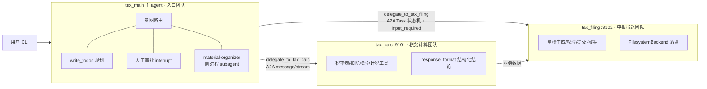

# tax-agent-demo

企业级 multi-agent 架子 demo：**deepagents**（agent 运行时）+ **A2A 协议**（跨团队 agent 通信）。

模拟真实企业形态：三个 agent 分属三个团队、独立开发、各自部署，主 agent 作为用户入口做意图路由，通过 A2A 协议跨进程委派 subagent。业务场景为**个税计税申报**（mock 数据，无真实税务系统）。

> 定位：POC 架子，不是生产可用。目标是把 deepagents 的特性都有落点、把 A2A 的关键能力（发现/流式/任务状态机/input_required）走通，供后续继续开发。

## 架构



- **星型拓扑**：主 → sub，sub 之间不直接互调（计税结论由主 agent 汇总后带给申报 agent）
- **协议层**：`shared/a2a_adapter/` 两个薄文件（server 适配器 + client 工具工厂），业务 agent 不感知协议细节——换协议只动这一层
- **服务发现**：`shared/config.py` 静态注册表模拟注册中心（真实企业等价物是 Nacos/Consul）

## deepagents 特性 → demo 落点

| deepagents 特性 | 落点 | 文件 |
|---|---|---|
| create_deep_agent 全参数装配 | 主 agent | `agents/main/tax_main/agent.py` |
| system_prompt / tools | 三个 agent | 各自 `agent.py` / `tools/` |
| TodoListMiddleware（write_todos） | 主 agent 显式装配（0.7.13 起移出默认栈） | `agent.py` middleware 参数 |
| in-process SubAgent（声明式 spec） | 资料整理员（tools 显式收窄权限，不继承委派工具） | `agent.py` MATERIAL_ORGANIZER_SUBAGENT |
| **A2A 远端委派**（handoff-as-tool 跨进程版） | delegate_to_tax_calc / delegate_to_tax_filing | `shared/a2a_adapter/client.py` |
| backend：CompositeBackend + FilesystemBackend + StoreBackend | 主 agent（workspace 真实磁盘 + /memories/ 长期记忆路由）；申报 agent（草稿落盘） | `agent.py` build_backend |
| MemoryMiddleware（AGENTS.md） | 主 agent 启动载入全局记忆 | `memory/AGENTS.md` |
| SkillsMiddleware（SKILL.md 懒加载） | 年度汇算指引、申报材料清单 | `skills/*/SKILL.md` |
| permissions（FilesystemPermission） | 技能目录 deny 写（防 prompt 注入篡改） | `agent.py` SKILL_DIR_READONLY |
| interrupt_on + checkpointer（HITL） | 委派申报前人工审批，CLI 内 approve/reject | `agent.py` + `cli.py` |
| state_schema 扩展 | last_tax_result（save_calc_result 工具经 Command 写入） | `state.py` + `tools/local_tools.py` |
| context_schema | 操作员/在办纳税人身份注入（工具经 runtime.context 读取，模型不可伪造） | `state.py` + `tools/local_tools.py` whoami |
| response_format 结构化输出 | 计税 agent 的 TaxCalcResult | `agents/calc/tax_calc/agent.py` |
| SummarizationMiddleware / PatchToolCallsMiddleware | 内置默认栈自动挂载（无需配置） | — |
| astream 流式 | CLI token 级文本流 + 节点级更新 | `cli.py` |

未用（留作演进）：AsyncSubAgentMiddleware（LangSmith 部署协议，非 A2A）、MCP、HarnessProfile。

## A2A 能力 → demo 落点

| A2A 能力 | 落点 |
|---|---|
| AgentCard 发现（/.well-known/agent-card.json） | 两个 subagent server；`scripts/doctor.py` 健康检查 |
| message/stream（SSE） | 委派工具默认走流式，聚合 artifact 文本 |
| Task 状态机（submitted→working→completed/failed） | `shared/a2a_adapter/server.py` DeepAgentExecutor |
| input-required 状态 | 申报缺材料场景：agent 回复 `[[NEED_INPUT]]` 前缀 → executor 翻译成协议状态 → 主 agent 转问用户 → 补齐后重新委派 |
| 错误语义 | 连接失败/任务失败映射为模型可读的 `[DELEGATE_*]` 文案（不暴露堆栈） |

SDK：`a2a-sdk[fastapi]` 1.3.0（A2A 1.0 JSONRPC 绑定）。**A2A 是开放协议、用官方 SDK 是工程选择**（传输/报文/状态机正确性由官方保证，且与 a2a-java 等生态真互通）；适配层已隔离，后续想换自研协议只动 `shared/a2a_adapter/`。

## 快速开始

```bash
cd tax-agent-demo

# 1. 安装（uv workspace，一次装齐主/计税/申报/公共件四个包）
uv sync --all-packages

# 2. 配置 LLM 端点（GLM / DeepSeek / Qwen / OpenAI 兼容端点均可）
cp .env.example .env   # 填 OPENAI_BASE_URL / OPENAI_API_KEY / MODEL_NAME

# 3. 拉起两个 A2A subagent（真实 HTTP 多进程，Ctrl-C 一起退）
bash scripts/start_all.sh

# 4.（另开终端）健康检查
uv run python scripts/doctor.py

# 5. 主 agent CLI
uv run python -m tax_main.cli --taxpayer-id T2025-001
```

无头模式（跑完即退，`--auto-approve` 用于冒烟）：

```bash
uv run python -m tax_main.cli --task "帮我算一下 T2025-001 的 2025 年个税" 
```

## 演示剧本（覆盖全部特性点）

前置：`bash scripts/start_all.sh` + `.env` 已配 key。

| # | 对 CLI 说 | 演示点 |
|---|---|---|
| 1 | `帮我算一下 T2025-001 张三 2025 年度的个税` | 意图路由 → A2A 委派计税 → response_format 结构化结论（应退 1720 元）→ save_calc_result 存档 |
| 2 | `确认无误，直接提交申报` | HITL：CLI 弹人工审批（y/n/理由）→ A2A 委派申报（Task working，提交含 2 秒模拟受理）→ 回执号 RCP-…；工作区出现 `agents/filing/tax_filing/workspace/return_draft_T2025-001_2025.json` |
| 3 | `帮我整理 T2025-002 李四的申报资料` | 同进程 subagent（资料整理员）+ workspace 文件 |
| 4 | `T2025-002 的申报怎么提交？材料有什么问题吗？` | 缺材料 → A2A input-required → 主 agent 转问用户 → 补齐后重新委派 |
| 5 | `我要做个年度汇算，流程是什么？` | Skills 懒加载（annual-reconciliation SKILL.md） |

### 零 key 验证

```bash
uv run python -m pytest          # 26 条：计税引擎手算对账 / 业务工具 / A2A 契约（fake model + 真 HTTP）
uv run ruff check . && uv run pyright
```

真实端点冒烟（两个 server 起来后）：

```bash
uv run python scripts/smoke.py   # 主 agent → A2A 计税 → HITL 自动批准 → A2A 申报 → 断言回执
```

## 目录结构

```
tax-agent-demo/
├── pyproject.toml          # uv workspace 根 = taxagent-shared（平台公共件）
├── shared/                 # "平台团队"公共件：llm 端点中立工厂 / agent 注册表 / A2A 薄适配层
├── agents/
│   ├── main/               # 主 agent（入口团队）：全特性装配 + CLI
│   ├── calc/               # 计税 agent（税务计算团队）：纯计算引擎 + 业务工具 + A2A server
│   └── filing/             # 申报 agent（申报报送团队）：草稿/校验/提交（幂等）+ A2A server
├── data/                   # mock：纳税人档案 ×3（含缺材料场景）、2025 税率表
├── scripts/                # start_all.sh / doctor.py / smoke.py
└── tests/                  # unit（零 key 纯函数）+ contract（fake model + 真 HTTP）
```

## 设计要点（后续开发会踩到的）

1. **金额一律整数元**；扣除非对称 fail-closed：佐证材料不齐的专项附加扣除不计入。
2. **幂等键**：申报提交必须带 `纳税人编号-年度` 格式幂等键（agent 是最凶的重复调用方）。
3. **`[[NEED_INPUT]]` 前缀约定**：业务 agent 用文本标记声明"要等补充信息"，协议翻译收敛在适配层。
4. **状态机细节**：`a2a-sdk` 1.3 是 proto 语义——未设置字段是空实例而非 None，判断一律用 `HasField`；executor 必须先入队初始 Task 再发状态更新。
5. **deepagents 0.7.13**：`backend` 参数是实例（非 callable）；`skills`/`memory` 路径相对 backend root；interrupt 恢复协议为 `Command(resume={"decisions": [...]})`。
6. **路径词汇统一**（真实冒烟踩过）：业务工具与 agent 内置文件工具共享 FilesystemBackend 时，工具返回值必须用 backend 相对路径——绝对路径会被 virtual_mode 拒读，模型陷入"复核失败→重试"死循环（回归测试 `test_路径词汇_相对路径全流程`）。
7. **委派预算**：每次 A2A 委派带 `recursion_limit`（适配层 RECURSION_LIMIT=60），模型失控循环时截断为可读 failed 任务，而不是跑满 deepagents 默认的 9999 层递归。
8. **DeepSeek 思考模式**：默认开启时拒绝 `tool_choice` 强制（langchain 结构化输出依赖它），.env 配 `LLM_EXTRA_BODY={"thinking": {"type": "disabled"}}` 关闭；GLM/Qwen 不需要。
9. **LLM 数字不可信**（冒烟实证）：模型最终文字汇总出现过"扣除明细 66000 但合计写 126000"的矛盾——勾稽校验只能验内部自洽，验不出与档案语义不符的漏项；生产化必须补 eval（见演进点）。

## 演进点（架子已预留位置）

- 持久化：checkpointer/store 换 Sqlite/Postgres（改 `agent.py` 一处）；mock 税务局受理记录目前存进程内存，重启即清空
- A2A 鉴权（AgentCard securitySchemes + 传输凭证）——代码中留有 TODO 位
- subagent 服务发现换注册中心（改 `shared/config.py` 一处）
- per-user 记忆命名空间（StoreBackend namespace 目前是全局单值）
- 申报长任务改真异步 job + 轮询句柄（tool-design 调研的"任务句柄三元组"模式）
- eval：按 TAU-bench 模式补真实任务评测
